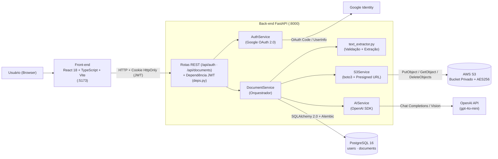

# Jus Digital — Gestão e Análise de Documentos Jurídicos com IA

Aplicação FullStack para upload, armazenamento seguro e análise inteligente de documentos com a **Ju** (assistente jurídica baseada em **OpenAI `gpt-4o-mini`**), integrando **Google OAuth 2.0**, **AWS S3** e **PostgreSQL**, com interface fiel ao protótipo do Figma (desktop e responsivo mobile).

---

## Sumário

- [Visão Geral e Funcionalidades](#visão-geral-e-funcionalidades)
- [Arquitetura do Sistema](#arquitetura-do-sistema)
- [Stack Escolhida](#stack-escolhida)
- [Decisões Arquiteturais](#decisões-arquiteturais)
- [Como Executar](#como-executar)
  - [1. Configurar Variáveis de Ambiente](#1-configurar-variáveis-de-ambiente)
  - [2. Subir tudo com Docker Compose (Recomendado)](#2-subir-tudo-com-docker-compose-recomendado)
  - [3. Rodar em Modo Desenvolvimento Local (Hot Reload)](#3-rodar-em-modo-desenvolvimento-local-hot-reload)
- [Deploy em Nuvem (Render + Supabase)](#deploy-em-nuvem-render--supabase)
- [Testes Automatizados](#testes-automatizados)
- [Infraestrutura como Código (Terraform) e CI](#infraestrutura-como-código-terraform-e-ci)
- [Endpoints da API](#endpoints-da-api)
- [Estrutura do Repositório](#estrutura-do-repositório)

---

## Visão Geral e Funcionalidades

- **Autenticação Segura via Google OAuth 2.0:** fluxo *Authorization Code* conduzido pelo back-end com validação de `state` anti-CSRF e sessão mantida via token **JWT** assinado em cookie **`HttpOnly`** (invisível para JavaScript no navegador).
- **Upload Inteligente com Validação em Camadas:** suporte a clique ou *drag-and-drop* para documentos (`.pdf`, `.docx`, `.doc`, `.txt`, `.md`, `.csv`) e imagens (`.png`, `.jpg`, `.jpeg`, `.webp`), com checagem de nome, extensão, limite de **10 MB** e assinatura binária real (*magic bytes*).
- **Análise com IA (`gpt-4o-mini`):**
  - Documentos de texto têm o conteúdo extraído (`pypdf`, `python-docx`) e analisado seguindo rigorosamente a instrução fornecida pelo usuário.
  - Imagens são enviadas em `base64` para análise multimodal (**Vision**).
- **Armazenamento Privado no AWS S3:** bucket **100% privado** com criptografia em repouso (`AES256`) e isolamento por prefixo de usuário (`users/{user_id}/documents/{document_id}/...`). A visualização/download pelo front-end utiliza **Presigned GET URLs** temporárias (15 minutos) geradas apenas após checagem de propriedade no back-end.
- **Resiliência e Retry sem Re-upload:** máquina de estados no PostgreSQL (`PROCESSING` → `COMPLETED` | `FAILED`). Caso a extração ou a chamada à OpenAI falhe, o arquivo já salvo no S3 e os metadados são preservados, permitindo acionar **"Tentar novamente"** sem reenviar o arquivo.
- **Exclusão Segura (Individual e em Lote):** seleção múltipla com modal de confirmação e verificação atômica de propriedade antes da remoção (tudo ou nada — só apaga do S3 e do PostgreSQL se todos os IDs pertencerem ao usuário).
- **Fidelidade ao Protótipo e Responsividade:** layout fiel aos tokens do Figma (paleta Radix, tipografia Geist, sidebar responsiva com drawer mobile) e regras sutis de UX (ex.: opção *Visualizar análise* disponível no menu apenas quando **1** documento está selecionado).

---

## Arquitetura do Sistema



---

## Stack Escolhida

| Camada | Tecnologia | Motivo da Escolha |
| :--- | :--- | :--- |
| **Front-end** | React 18, TypeScript, Vite, TailwindCSS, Lucide React | Tipagem estática estrita (`tsc -b`), build rápido e controle granular para fidelidade ao protótipo do Figma em desktop e mobile. |
| **Back-end** | Python 3.11, FastAPI, Pydantic v2, PyJWT | Validação automática de schemas, documentação interativa OpenAPI/Swagger (`/docs`), desempenho assíncrono e clareza na camada de serviços. |
| **Banco e ORM** | PostgreSQL 16, SQLAlchemy 2.0, Alembic | Integridade relacional com `UUID` nativo, relacionamento `User -> Document` com `ON DELETE CASCADE` e migrações versionadas. |
| **Storage** | AWS S3 (`boto3`) | Armazenamento durável e privado para arquivos binários, mantendo o banco relacional enxuto e seguro. |
| **IA** | OpenAI SDK (`gpt-4o-mini`) | Modelo rápido e econômico indicado para o desafio, com suporte unificado a texto extraído e análise de imagens via Vision. |
| **Infra & Qualidade** | Docker, Docker Compose, Nginx, Terraform, Pytest, GitHub Actions | Ambiente reproduzível em 1 comando, provisionamento declarativo do bucket S3/IAM e pipeline de CI automático. |

---

## Decisões Arquiteturais

1. **Upload Multipart pelo Back-end vs. Presigned PUT direto do Browser**
   - Optou-se por receber o arquivo via `multipart/form-data` no FastAPI, validar extensão, tamanho (10 MB) e *magic bytes*, enviar ao S3 e disparar a análise no mesmo fluxo. Como o limite de upload é 10 MB, isso elimina a superfície de manipulação direta no bucket, simplifica o tratamento de falhas e evita objetos órfãos no S3 quando uma validação falha.

2. **Bucket S3 100% Privado + Presigned GET URLs**
   - Nenhum objeto no S3 possui acesso público e a coluna `s3_key` nunca é exposta na resposta da API. Toda leitura passa pela rota autenticada que verifica `document.user_id == current_user.id` antes de emitir uma URL assinada com expiração de 15 minutos (`AWS_PRESIGNED_URL_EXPIRATION=900`).

3. **Autenticação OAuth no Back-end + Cookie `HttpOnly`**
   - O `GOOGLE_CLIENT_SECRET` permanece estritamente no servidor, e a sessão JWT viaja em cookie `HttpOnly` com `SameSite` configurado por ambiente (e validação de `state` aleatório no callback OAuth contra *Login CSRF*). Isso impede que scripts no navegador leiam tokens em `localStorage`.

4. **Persistência Resiliente (`S3 -> PostgreSQL -> IA`)**
   - O arquivo bruto é enviado ao S3 **antes** de gravar a linha no PostgreSQL (se o S3 falhar, nada é persistido no banco; se o `commit` no banco falhar após o upload, um rollback compensatório remove o objeto do S3 para evitar arquivos órfãos). Após o upload bem-sucedido, o registro é salvo como `PROCESSING` e então enviado à IA. Em caso de timeout, cota ou PDF sem texto selecionável, o status vira `FAILED` com mensagem amigável e o botão **Tentar novamente** reutiliza o arquivo já armazenado no S3.

5. **Segurança e Sanitização de Erros**
   - Falhas de serviços externos (`boto3`, `openai`, parsers de PDF/DOCX e verificação de token Google) são registradas nos logs do servidor (`logger.exception` / `logger.warning`), retornando ao cliente apenas mensagens amigáveis em português — sem expor nomes de bucket, chaves S3, endereços internos ou stack traces.

---

## Como Executar

### Pré-requisitos

- **Docker Desktop** (com Docker Compose)
- **Para rodar fora do Docker em modo dev (opcional):** Python 3.11+ e Node.js 20+
- Credenciais configuradas para:
  - **Google OAuth 2.0** (`GOOGLE_CLIENT_ID` e `GOOGLE_CLIENT_SECRET` com redirect URI `http://localhost:8000/api/auth/google/callback`)
  - **AWS S3 + IAM** (bucket privado e usuário IAM com permissões `PutObject`, `GetObject`, `DeleteObject` e `ListBucket`)
  - **OpenAI API** (`OPENAI_API_KEY`)

### 1. Configurar Variáveis de Ambiente

Copie o template `.env.example` para `.env` na raiz do repositório e preencha suas credenciais:

```bash
cp .env.example .env
```

> **Importante:** o arquivo `.env` está listado no `.gitignore` e nunca deve ser versionado.

Principais variáveis configuradas no `.env`:

| Variável | Descrição | Exemplo / Padrão |
| :--- | :--- | :--- |
| `FRONTEND_URL` / `BACKEND_URL` | Origens permitidas no CORS e redirecionamento OAuth | `http://localhost:5173` / `http://localhost:8000` |
| `JWT_SECRET_KEY` | Chave secreta para assinar o cookie JWT de sessão | Gerar com `secrets.token_hex(32)` |
| `POSTGRES_*` / `DATABASE_URL` | Credenciais do banco PostgreSQL local | `jusdigital` / `jusdigital_db` |
| `GOOGLE_CLIENT_ID` / `SECRET` | Credenciais OAuth 2.0 do Google Cloud | `...apps.googleusercontent.com` |
| `AWS_REGION` / `AWS_S3_BUCKET_NAME` | Região e nome do bucket privado no S3 | `sa-east-1` |
| `AWS_ACCESS_KEY_ID` / `SECRET` | Chaves do usuário IAM dedicado ao S3 | — |
| `OPENAI_API_KEY` / `OPENAI_MODEL` | Chave e modelo usado pelo `AIService` | `gpt-4o-mini` |

### 2. Subir tudo com Docker Compose (Recomendado)

Com o `.env` preenchido e o Docker em execução:

```bash
docker compose up --build
```

Esse comando sobe os 3 serviços conectados em rede interna:
- **PostgreSQL 16** com *healthcheck* e volume persistente (`postgres_data`)
- **Back-end FastAPI** (aplica automaticamente as migrações Alembic no startup e expõe a API em `http://localhost:8000` e Swagger em `http://localhost:8000/docs`)
- **Front-end React/Vite** compilado em build multi-stage servido via **Nginx** em `http://localhost:5173`

### 3. Rodar em Modo Desenvolvimento Local (Hot Reload)

Para rodar Postgres no Docker com back-end (`uvicorn --reload`) e front-end (`vite`) locais simultaneamente:

1. Instale as dependências uma única vez:
   ```bash
   # Back-end
   python -m venv backend/.venv
   # Windows: backend\.venv\Scripts\pip install -r backend/requirements.txt
   # Linux/macOS: backend/.venv/bin/pip install -r backend/requirements.txt

   # Front-end
   cd frontend && npm install && cd ..
   ```

2. Suba o ambiente integrado com um único comando:
   - **Windows (PowerShell):**
     ```powershell
     .\dev.ps1
     ```
   - **Linux / macOS:**
     ```bash
     python3 scripts/dev.py
     ```

   Opções disponíveis: `--backend` (`-Backend`), `--frontend` (`-Frontend`) e `--test` (`-Test`).

---

## Deploy em Nuvem (Render + Supabase)

Durante a entrega e apresentação do desafio, a aplicação também foi publicada em nuvem com a arquitetura abaixo *(instâncias gratuitas desativadas após a apresentação conforme orientação de encerramento de recursos; utilize `docker compose up --build` para execução local)*:

- **Front-end (Render Static Site):**
  - Build estático React + Vite configurado com `VITE_API_URL=/` e regra de fallback SPA (`/* → /index.html`).
  - **Proxy Reverso (`/api/* → back-end`):** encaminha todas as chamadas de API sob a mesma origem HTTPS do front-end, mantendo o cookie JWT `HttpOnly` como *first-party cookie* e evitando bloqueios de *third-party cookies*.
- **Back-end (Render Web Service — Docker):**
  - Executa o [backend/Dockerfile](backend/Dockerfile) (`PORT=8000`, `APP_ENV=production` com cookies `Secure`) aplicando migrações Alembic automaticamente no startup.
  - **Keep-alive:** Cron Job consultando `/health` a cada 10 minutos para evitar *cold start* durante a avaliação.
- **Banco de Dados (Supabase PostgreSQL):**
  - Conectado via **Session Pooler (IPv4, porta `5432`)** para compatibilidade com o Render e suporte completo a migrações Alembic.
  - **Data API REST pública desativada:** reduz a superfície de ataque garantindo que nenhuma tabela fique exposta fora do FastAPI (acesso exclusivo via `DATABASE_URL` autenticada).

---

## Testes Automatizados

A suíte de testes do back-end conta com **76 testes unitários e de integração** em `pytest`, cobrindo autenticação JWT/cookie e CSRF OAuth, isolamento de autorização entre usuários, validação de *magic bytes* e extração de documentos (`.pdf`, `.docx`, `.doc`, `.txt`, `.md`, `.csv` e imagens), pipeline de upload, rollback compensatório S3/DB, falha + retry no S3, sanitização de erros e cascade no banco.

Os testes executam totalmente isolados em **SQLite em memória** com *fakes* para AWS S3 e OpenAI (sem depender de `.env` ou rede externa):

```powershell
# Windows (via script DX)
.\dev.ps1 -Test

# Ou diretamente via Python no diretório backend/
python -m pytest -v
```

Para validar também a tipagem e build de produção do front-end:

```bash
cd frontend && npm run build
```

---

## Infraestrutura como Código (Terraform) e CI

### Terraform (`infra/`)

O diretório `infra/` disponibiliza a configuração Terraform para provisionar de forma repetível o ambiente AWS necessário ao projeto:
- Bucket S3 com `BucketOwnerEnforced`, bloqueio total de acesso público, criptografia padrão `AES256` e CORS restrito ao `FRONTEND_URL`.
- Usuário IAM dedicado (`jus-digital-backend-s3`) com política *least-privilege* restrita exclusivamente ao bucket do projeto.

```bash
cd infra
cp terraform.tfvars.example terraform.tfvars
terraform init
terraform plan
```

### Integração Contínua (`.github/workflows/ci.yml`)

A cada `push` ou `pull_request` na branch `main`, o GitHub Actions valida automaticamente:
1. **Back-end:** compilação Python (`compileall`), geração do schema OpenAPI e execução dos **76 testes** no `pytest`.
2. **Front-end:** verificação de tipos TypeScript (`tsc -b`) e build de produção com Vite.
3. **Infra e Containers:** validação do `docker-compose.yml` e checagem de formatação/sintaxe do Terraform (`terraform fmt -check` e `terraform validate`).

---

## Endpoints da API

Documentação interativa completa disponível em `http://localhost:8000/docs` com o back-end em execução.

| Método | Rota | Descrição |
| :--- | :--- | :--- |
| `GET` | `/health` | Verifica saúde da API e conectividade com o PostgreSQL. |
| `GET` | `/api/auth/google/login` | Inicia o fluxo OAuth 2.0 gerando o cookie `state` anti-CSRF. |
| `GET` | `/api/auth/google/callback` | Valida `state`, troca o `code` no Google e grava cookie JWT `HttpOnly`. |
| `POST` | `/api/auth/google/token` | Troca alternativa via JSON (`code` ou `credential`) pelo cookie de sessão. |
| `GET` | `/api/auth/me` | Retorna os dados do usuário autenticado. |
| `POST` | `/api/auth/logout` | Remove o cookie de sessão `HttpOnly`. |
| `POST` | `/api/documents` | Upload `multipart/form-data`, validação, S3, extração e análise com IA. |
| `GET` | `/api/documents` | Lista documentos do usuário autenticado com *Presigned GET URLs*. |
| `GET` | `/api/documents/{document_id}` | Detalhes de um documento específico do usuário. |
| `POST` | `/api/documents/{document_id}/retry` | Reprocessa a análise de IA lendo o arquivo já armazenado no S3. |
| `DELETE` | `/api/documents/{document_id}` | Remove um documento do AWS S3 e do PostgreSQL. |
| `POST` | `/api/documents/bulk-delete` | Remove múltiplos documentos selecionados de forma atômica na checagem de posse. |

---

## Estrutura do Repositório

```text
Jus-Digital/
├── .github/workflows/
│   └── ci.yml                  # Pipeline CI (Back-end, Front-end, Docker e Terraform)
├── backend/
│   ├── alembic/                # Migrações de banco de dados (0001_initial_schema.py)
│   ├── app/
│   │   ├── api/
│   │   │   ├── deps.py         # Autenticação via cookie HttpOnly ou Bearer JWT
│   │   │   └── routes/         # Rotas REST (auth.py, documents.py)
│   │   ├── core/               # Config (Settings), Database, Exceptions, Security (JWT)
│   │   ├── models/             # Models SQLAlchemy (User, Document, DocumentStatus)
│   │   ├── schemas/            # Schemas Pydantic v2
│   │   ├── services/           # AuthService, DocumentService, S3Service, AIService, TextExtractor
│   │   └── main.py             # App FastAPI, CORS, healthcheck e handlers globais
│   ├── tests/                  # Suíte pytest (76 testes isolados)
│   ├── Dockerfile
│   ├── pyproject.toml
│   └── requirements.txt
├── frontend/
│   ├── src/
│   │   ├── assets/icons/       # Ícones SVG extraídos do protótipo Figma
│   │   ├── components/         # Sidebar, ActionBar, DocumentCard, Modais
│   │   ├── contexts/           # AuthContext
│   │   ├── pages/              # LoginPage, DocumentsPage
│   │   ├── services/           # Cliente HTTP fetch com credentials: "include"
│   │   └── types/              # Tipagens TypeScript
│   ├── Dockerfile              # Build multi-stage Node 20 -> Nginx 1.27
│   └── nginx.conf
├── infra/                      # Provisionamento AWS S3 + IAM via Terraform
├── scripts/dev.py              # Script cross-platform de desenvolvimento e testes
├── dev.ps1                     # Atalho PowerShell para scripts/dev.py
├── docker-compose.yml          # Orquestração PostgreSQL + Back-end + Front-end
├── .env.example                # Modelo de variáveis de ambiente
└── README.md
```
